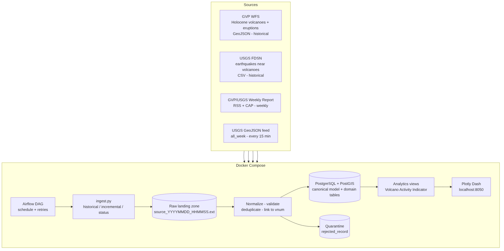

# Volcanic Activity Monitoring System

**Team 6 · Data Analysis Programming 2026-II · Universidad Distrital Francisco José de Caldas**
Professor: Eng. Carlos Andrés Sierra, M.Sc.

| Student code | Name |
|---|---|
| 20231020006 | Juan Rangel |
| 20231020055 | Jhonatan David Vergara Jiménez |
| 20231020064 | Julián Pulido |

## Hazard

Volcanic activity: unrest and eruptions of the ~1,400 volcanoes thought to have been active during the Holocene. The system integrates the **eruption history** and **static characteristics** of each volcano with **current activity reports** and **nearby seismicity**. It produces a **Volcano Activity Indicator** per volcano. The indicator is a monitoring and correlation aid, **not an eruption forecast**.

* **Geographic scope:** global (all Holocene volcanoes in the Smithsonian GVP database).
* **Historical window:** earthquakes from 2010-01-01 to today. Eruption history covers the whole Holocene record; time-series analysis starts in 1960.
* **Current situation:** the latest Weekly Volcanic Activity Report and earthquakes from the last 7 days within 30 km of a volcano.

## Sources

| ID | Source | Role | Format | Licence / attribution |
|---|---|---|---|---|
| `gvp_volcanoes`, `gvp_eruptions` | Smithsonian GVP *Volcanoes of the World* (WFS) | historical | GeoJSON | Cite the database version and DOI (v5.4.0, 7 Aug 2026, doi:10.5479/si.GVP.VOTW5-2026.5.4) |
| `usgs_fdsn` | USGS FDSN Event Web Service (ComCat) | historical | CSV | Public domain, credit USGS |
| `gvp_weekly_rss` | Smithsonian / USGS Weekly Volcanic Activity Report | incremental (weekly) | RSS XML (+ CAP) | Cite GVP Weekly Report |
| `usgs_feed` | USGS real-time GeoJSON feed `all_week` | incremental (minutes) | GeoJSON | Public domain, credit USGS |
| `gdacs_vo`, `usgs_hans` | GDACS (VO) / USGS HANS | optional | JSON | see `config/sources.yaml` |

None of these sources needs an API key. Full details (URLs, limits, watermarks, duplicate keys) are in [`config/sources.yaml`](config/sources.yaml) and [`workshop_1/ingestion_contract.md`](workshop_1/ingestion_contract.md).

## Architecture



Docker Compose stack (Workshop #2+): PostgreSQL + PostGIS, Airflow (incremental schedule), the ingestion application (`ingest.py`), and a Plotly Dash dashboard on `localhost:8050`.

## Repository structure

```
├── ingest.py                  # CLI: --mode historical | incremental | status
├── config/sources.yaml        # one entry per source (URL, format, schedule, watermark, licence)
├── src/volcano_pipeline/
│   ├── config.py              # loads YAML + .env
│   ├── sources/               # HTTP clients: gvp, usgs_fdsn, usgs_feed, weekly_report
│   ├── normalization/         # canonical mapping, geo helpers
│   └── storage/               # raw landing zone (DB repository in Workshop #2)
├── data/raw/                  # raw landing zone (git-ignored)
├── sql/                       # schema definitions (draft DDL)
├── dashboard/                 # Dash app (Workshop #4)
├── tests/ and tests/fixtures/ # pytest + recorded responses
├── notebooks/01_source_profiling.ipynb
├── scripts/fetch_samples.py   # downloads the Workshop #1 evidence samples
├── docs/                      # ER diagram, architecture, report sources
└── workshop_1/                # mapping, ingestion contract, samples, source status log
```

## Quick start (Workshop #1)

```bash
python -m venv .venv && source .venv/bin/activate      # Windows: .venv\Scripts\activate
pip install -r requirements.txt
cp .env.example .env                                     # set HTTP_USER_AGENT with a team e-mail

python scripts/fetch_samples.py                          # 1st poll: all sources -> workshop_1/samples
#   ... wait at least 1 hour ...
python scripts/fetch_samples.py --poll                   # 2nd poll of the incremental sources
#   ... after the next Wednesday 23:00 UTC ...
python scripts/fetch_samples.py --poll                   # 3rd poll: new weekly report
python scripts/fetch_samples.py --estimate-volume        # optional: FDSN counts for all selected volcanoes

jupyter nbconvert --to notebook --execute --inplace notebooks/01_source_profiling.ipynb
python ingest.py --mode status
pytest -q
```

## CLI contract

```bash
python ingest.py --mode historical [--start 2010-01-01 --end 2025-12-31]   # Workshop #2
python ingest.py --mode incremental                                        # Workshop #3
python ingest.py --mode status                                             # watermarks, last runs, row counts
```

## Workshop deliverables

* **Workshop #1:** [`workshop_1/`](workshop_1/): mapping table, ingestion contract, samples, source status log. Also the notebook, the ER diagram ([`docs/er_diagram.png`](docs/er_diagram.png)) and the draft DDL ([`sql/001_schema_draft.sql`](sql/001_schema_draft.sql)).
